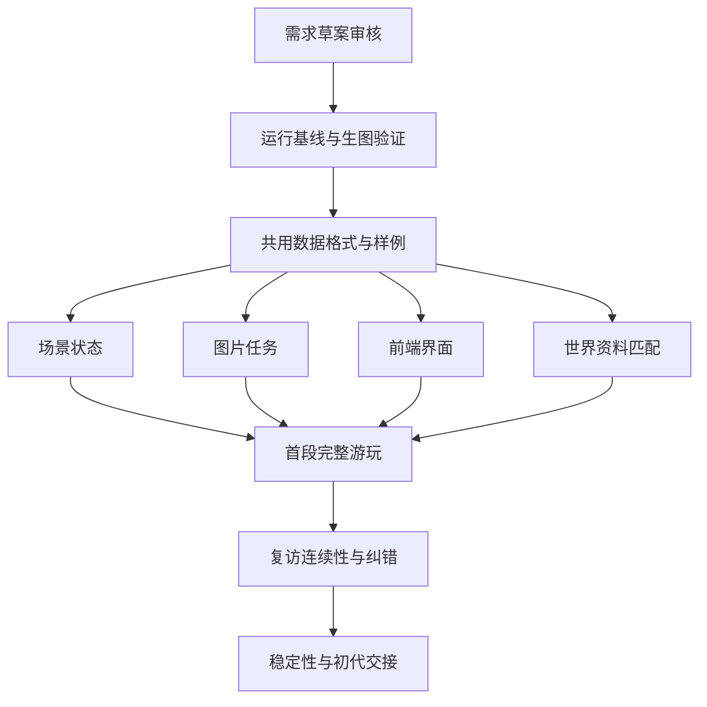

# 九霄映界 初代需求草案与开发任务序列

> 历史快照：本文件保留用户宣布启动前的草案0.1原文。当前启动授权、独立仓库决定和任务状态以[决策台账](../decisions.md)及[任务序列](../task-sequence.md)为准。

**版本：草案 0.1｜日期：2026 年 11 月 19 日｜状态：待道主审核。**

《九霄 · 映界》初代以既有 Nine-cloud 工程为基础，让修仙文字剧情产生能够延续、复访和变化的场景画面。开发投入意愿已确认为 1–2 个月；建议按 6–8 周组织工作，前四周形成核心游玩流程，后四周集中改善连续性和稳定性。

本稿依次给出需求、任务序列、并行分工和技术框架。需求状态与实施顺序分开记录：“已确认的需求”不等于“本稿建议的首版范围已经获批”。本轮授权覆盖规划，开发任务均未启动，执行者尚未派发。正式验收细则以及此前第 2–5 项疑问按道主指示后置。

# 一 产品定义与优先级

映界是《九霄》中的视觉游玩模式。玩家继续通过文字行动和阅读剧情探索世界，画面表现当前能够看到的地点、人物与重要变化。核心感受是“一帧能够持续变化的开放世界”：第一次进入酒馆有几个人，救回其他人后再回来，仍能认出原来的酒馆，并看到剧情带来的改变。

剧情事实优先是已确认原则。本稿建议在开发取舍中依次保障世界的连续性、沉浸感与关键场面表现，再调整速度和画面精细度；除剧情优先外，这一排序尚待审核，具体阈值后定。图片不能反过来改变剧情，画面中的偶然细节不能自动成为世界设定。

初代背景固定为修仙，主要依据已有世界书，并允许剧情在未规定处创造新内容。形成新事实后，应在当前存档中持续保留。通用题材扩展进入后续阶段。

# 二 需求台账

状态定义：**已确认**表示来自用户明确回答或此前访谈整理；**暂定**表示用户倾向、存在编号歧义的解释或本稿建议；**未决定**表示尚未确定或明确后置；**明确否定**表示用户拒绝的行为。Q 编号对应本次访谈，原始答复中的“53C54B56C56B”保留为 Q055/Q056 编号疑点，不据此冻结界面布局。

下表记录产品需求，第四节单独给出首版安排建议。

| 编号 | 需求与约束 | 状态 | 来源 |
| --- | --- | --- | --- |
| R01 | 用静态场景画面表现持续存在、会随行动变化的世界，增强探索欲与代入感 | 已确认 | Q001–004 |
| R02 | 文字剧情优先；图片体现剧情，不推翻剧情，也不凭图增加新事实 | 已确认 | Q008、Q030、Q046 |
| R03 | 初代固定修仙，以已有世界书为基础；通用版后续再做 | 已确认 | Q021、Q087 |
| R04 | 世界书提前规定重要内容，未规定的部分允许创造；可用预设与复用降低难度 | 已确认 | Q008、Q021、Q028、Q036、Q039 |
| R05 | 进入区域是主要出图时机；同一区域内部的重要变化也属于初代需求 | 已确认 | Q013、Q094 |
| R06 | 关键剧情、高潮和大场面由 AI 结合剧情判断；价值低的段落可以复用或不出新图 | 已确认 | Q026、Q031、Q057 |
| R07 | 同一重要地点再次出现时应尽量合理、连续，允许改变观察角度但保留地点特征 | 已确认 | Q006、Q032 |
| R08 | 记录当前存档的可见变化与结果，不要求每件细小道具都达到像素级一致 | 已确认 | Q041–042 |
| R09 | 视野大小随剧情和主角位置变化，可以是村庄，也可以是飞行时脚下的山脉 | 已确认 | Q018 |
| R10 | 画面视角配合文字采用的人称，避免显示主角尚不知道的秘密 | 已确认 | Q035、Q037–038 |
| R11 | 固定预设图、世界书重点地点图和动态生成可以混合使用 | 已确认 | Q028–029、Q092–095 |
| R12 | 有合适旧图可以复用；旧图与当前剧情矛盾时应隐藏或替换 | 已确认 | Q051、Q053、Q057 |
| R13 | 不确定或明显矛盾的图宁可不展示；保留简单纠错和重新生成能力 | 已确认 | Q033、Q045–046 |
| R14 | 玩家可以关闭生图；没有图片服务时仍可正常进行文字游玩 | 已确认 | Q015、Q066 |
| R15 | 图片与文字尽量及时配合，生图等待或失败不应阻塞文字；具体延迟后定 | 已确认 | Q011、Q051、Q058–059、Q082 |
| R16 | 手机与电脑都需要良好体验；图片有独立展示区域；不同分辨率尽量保持相同画面内容 | 已确认 | Q049–050、Q054、Q060 |
| R17 | 希望有按时间和按地点组织的图片历史，图片能够关联对应剧情并跟随存档 | 已确认 | Q052、Q072 |
| R18 | 希望有删除单图、清理本档图片和导出能力；具体首版深度尚未冻结 | 已确认 | Q080 |
| R19 | 玩家初始外观可以设定，后续外观随剧情变化；重要人物形象逐步固定 | 已确认 | Q070、Q073–075 |
| R20 | 玩家自带第三方 API；平台不承担玩家的生成费用；先支持少量供应商 | 已确认 | Q061–062、Q065、Q068 |
| R21 | 希望看到调用次数、费用估算及预算提示；资金归属细节与产品化安排后置 | 已确认 | Q063、Q067及最新指示 |
| R22 | 在九霄中提供映界入口；与现有文字玩法衔接方式以实际工程验证为准 | 已确认 | Q085–086 |
| R23 | 地图用于理解宗门、地区与大陆的位置关系；先做好叙事和图片再推进地图 | 已确认 | Q013、Q018–020、Q090 |
| R24 | 图片内容遵循平台内容规则，生图拒绝不影响可继续进行的合规文字剧情 | 已确认 | Q077–079 |
| R25 | 首批面向自己和熟人试玩，已有 15–30 分钟体验目标；正式验收细则后定 | 已确认 | Q007、Q084、Q096及最新指示 |
| R26 | 旧存档兼容暂不作为当前前置条件；网站尚未公开是用户给出的项目背景 | 已确认 | Q088 |
| R27 | 开发初代愿意投入 1–2 个月 | 已确认 | 最新时间投入答复 |
| R28 | 地图和场景切换的具体形式、历史图片如何跳转文字 | 暂定 | Q055/Q056 编号重复 |
| R29 | 首版以独立角色卡会话作为优先接入候选 | 暂定 | 仓库核查后的建议 |
| R30 | 6–8 周排期、首个生图适配器、本文任务与分工 | 暂定 | 本稿建议 |
| R31 | 图片像素、比例、具体模型、触发阈值、判错阈值与重试次数 | 未决定 | Q013、Q047及未冻结实现项 |
| R32 | 费用归属细节、多人范围、视觉素材准备安排、密钥保存方式 | 未决定且后置 | 最新答复“2345都不要考虑” |
| R33 | 正式验收指标、公开发布范围与日期 | 未决定且后置 | 用户要求验收之后再说 |
| R34 | 图片推翻剧情、明显穿帮仍强行显示 | 明确否定 | Q030、Q046 |
| R35 | 平台代付玩家的生成费用 | 明确否定 | Q062 |
| R36 | 违法内容，以及擅自与万卡阁混用代码、数据或私人素材 | 明确否定 | Q077、原交接书 |

# 三 典型游玩流程

## 普通对话

玩家已经在酒馆中，与店家交谈。剧情推进但地点、在场人员和可见状态没有实质变化时，可以继续使用当前图片。讨论别处的山峰、回忆旧事或提出未来计划，不应被误认成角色已经到达新地点。关闭生图时，文字流程继续。

## 探索与返回地点

玩家第一次进入酒馆，系统结合已知世界书和当前剧情生成或匹配图片，并保存这个地点的身份及画面版本。玩家离开并救下几个人，剧情确认这些人来到酒馆后，再次进入时应读取同一地点、已发生变化和旧参考图，生成新版本。旧图仍属于原回合，新图属于新的场景状态；不能因别名变化把同一家酒馆重新随机建造。

## 高潮与战斗

当文字剧情进入渡劫、重要战斗、救援或其他高潮时，AI 判断是否值得更新画面。画面依据已经呈现的关键结果与玩家可知信息，可以采用适合叙述的角度。不能提前画出尚未发生的胜负、隐藏敌人或未揭示身份。“大场面”由剧情意义决定，不仅是建筑或山川的尺寸。

## 等待与失败

图片生成中，文字仍可推进。旧图仍符合当前场景时可以保留；已经与剧情冲突则隐藏。迟到的图片只有在仍适合当前视觉状态时才能进入当前视窗，否则只关联原来的历史位置。明确失败可以按规则有限重试；结果未知时先查询原请求，避免盲目重复生成。图片服务拒绝或不可用时保留文字游玩。

# 四 初代范围建议

**建议把初代定义为可持续试玩的修仙视觉模式。** 一个月优先形成完整但粗糙的核心流程，两个月用于连续性、纠错和稳定性。以下安排是待审核建议，后续需求仍保留在台账中。

| 层级 | 建议包含的内容 | 依赖与说明 |
| --- | --- | --- |
| 初代必须优先形成 | 修仙世界书接入、映界入口、文字与图片展示、进入区域及区域内重要变化触发、关闭生图 | 先确定实际可运行的文字会话接入路径 |
| 初代核心能力 | 地点稳定身份、当前可见状态、行动后果记录、预设图与旧图复用、参考图更新 | 地点连续性不能以赶工为由删掉 |
| 初代必要收尾 | 结果归属、过期结果拦截、失败恢复、简单纠错、基本图片历史、手机与电脑适配 | 跟随核心流程同步建设，不集中拖到最后一周 |
| 初代基础支持 | 调用与失败记录、当前会话的配置入口、图片与剧情关联、按会话隔离 | 具体收费产品、多用户密钥管理方案继续后置 |
| 核心稳定后的候选 | 更丰富的地点历史、导出与删除体验、更多外观入口、更多供应商、详细费用看板 | 若纳入同一周期，需要明确替换其他工作量 |
| 后续阶段 | 地图关系与探索图鉴、不同尺度的地点组织、更多题材与更强视觉一致性 | 地图先有位置与层级，再决定画面如何组织 |
| 本轮不作为前置条件 | 实时三维世界、自训模型、完整工作流编辑器、向量数据库、微服务拆分 | 属于技术范围建议，不是用户永久否定的功能 |

地图存在一项需要保留的设计问题：Q018 允许村庄与山脉采用不同视野尺度，因此这些图片不天然具备相同地图比例。首版可以保存地点层级、关联和图片归属；后续再确定关系地图、分层图鉴或需要额外控制条件的画面拼接方式。不能在当前草案中承诺任意图片可以无缝拼成统一比例地图。

# 五 当前工程基础

本稿以 Nine-cloud 主线提交 [1bd7bb5](https://github.com/L-core-dev-team/Nine-cloud/commit/1bd7bb5ff6e6221378a7cb1292e559fb19bfbfbc) 为核查基线。源码核查与已有联测回执支持以下结论；当前可运行性仍由 YJ-01 复核。

| 已有基础 | 可以复用什么 | 需要补什么 |
| --- | --- | --- |
| React/Vite、Hono、PostgreSQL | 页面、接口、数据库与既有工程组织 | 映界专有功能及真实接入 |
| 独立角色卡会话 | 世界书、Persona、历史保存、修订号、原请求回读 | 地点视觉状态及生图结果归属 |
| 原生权威回合 | 存档版本、分支、结果提交、状态和记忆的隔离思路 | 与映界的适配边界；不能假定与角色卡会话已经互通 |
| 34 条公开运行时设定 | 修仙背景和检索内容 | 按玩家可知范围形成画面资料 |
| 74 张画卷索引及四类固定场景 | 预设图片、显示方式和视觉参考 | 语义匹配、当前状态适配与动态更新 |
| 已有测试工具 | 类型检查、单元测试和浏览器流程测试 | 映界关键状态转换与连续游玩证据 |

源码依据：[前端依赖](https://github.com/L-core-dev-team/Nine-cloud/blob/1bd7bb5ff6e6221378a7cb1292e559fb19bfbfbc/apps/web/package.json)、[后端依赖](https://github.com/L-core-dev-team/Nine-cloud/blob/1bd7bb5ff6e6221378a7cb1292e559fb19bfbfbc/apps/api/package.json)、[角色卡服务](https://github.com/L-core-dev-team/Nine-cloud/blob/1bd7bb5ff6e6221378a7cb1292e559fb19bfbfbc/apps/api/src/card-import/service.ts)、[存档契约](https://github.com/L-core-dev-team/Nine-cloud/blob/1bd7bb5ff6e6221378a7cb1292e559fb19bfbfbc/packages/contracts/src/save.ts)、[世界书](https://github.com/L-core-dev-team/Nine-cloud/blob/1bd7bb5ff6e6221378a7cb1292e559fb19bfbfbc/packages/content/src/canon-runtime.json)、[画卷索引](https://github.com/L-core-dev-team/Nine-cloud/blob/1bd7bb5ff6e6221378a7cb1292e559fb19bfbfbc/apps/web/src/candidate-atlas.ts)、[根脚本与测试工具](https://github.com/L-core-dev-team/Nine-cloud/blob/1bd7bb5ff6e6221378a7cb1292e559fb19bfbfbc/package.json)。

角色卡真实模型联测回执记录了四次限定范围真实调用通过，但当前接入仍有本地开发宿主限制。角色卡生成读取最多 50 轮历史，超出预算还会裁剪，所以地点与可见变化必须独立保存。固定场景映射对未知地点默认显示山门，这种兜底不应直接用于映界当前场景。[联测回执](https://github.com/L-core-dev-team/Nine-cloud/blob/1bd7bb5ff6e6221378a7cb1292e559fb19bfbfbc/docs/CARD-REAL-PLAY-01-RECEIPT.md) · [本地宿主](https://github.com/L-core-dev-team/Nine-cloud/blob/1bd7bb5ff6e6221378a7cb1292e559fb19bfbfbc/apps/api/src/card-import/local-runtime.ts) · [场景映射](https://github.com/L-core-dev-team/Nine-cloud/blob/1bd7bb5ff6e6221378a7cb1292e559fb19bfbfbc/packages/content/src/scenes/manifest.ts)

# 六 按依赖顺序实施的任务

所有开发项当前状态为**未启动**。周数从获准启动后的时间计算；表中的完成检查是工程交付证据，不替代道主后续决定的正式产品验收指标。每一项都应能单独交接，记录输入、改动范围、实际结果和下一依赖。

| 任务 | 前置依赖 | 交付与完成检查 | 建议窗口 |
| --- | --- | --- | --- |
| YJ-00 审阅需求与首版范围 | 本稿 | 保留已确认需求，标明接受或修改的范围建议；不把后置事项擅自补成决定 | 当前 |
| YJ-01 固定运行基线 | YJ-00 | 隔离开发副本、固定提交和锁文件；跑通现有建局、行动、文字保存和继续；确定采用哪条会话与宿主路径 | 第1周 |
| YJ-02 验证关键生图能力 | YJ-01 | 用同一酒馆验证初图、参考图更新、增加人物和返回场景；记录实际模型能力、失败与限制 | 第1周 |
| YJ-03 明确共用数据格式 | YJ-01、YJ-02 | 约定场景、变化、任务、结果、错误和历史的字段与示例；准备成功、失败、迟到等样例 | 第1–2周 |
| YJ-04 场景身份与变化记录 | YJ-03 | 稳定地点编号、别名、视觉版本和可见变化；区分现在、回忆、计划与猜测；能从存储恢复 | 第2–3周 |
| YJ-05 图片生成与任务处理 | YJ-03、YJ-02 | 首个适配器、任务状态、参考图、结果保存、有限重试与未知结果查询；校验会话归属 | 第2–3周 |
| YJ-06 映界界面 | YJ-03 | 入口、独立图片区、文字区、等待与失败状态、生图开关；先用样例开发，再接真实接口 | 第2–3周 |
| YJ-07 世界书与预设图匹配 | YJ-03 | 复用已核验的世界书与资产目录，补充地点标签、适用条件和版本；匹配失败可留空 | 第2–4周 |
| YJ-08 串通首段真实游玩 | YJ-04、05、06、07 | 真实文字结果进入画面决策，图片显示并与回合关联；关闭生图、失败和恢复都能走通 | 第3–4周 |
| YJ-09 做好返回地点与持续变化 | YJ-08 | 酒馆复访、人员增减、地点改名与状态变化；新旧图片分别归属正确状态；重复会话不串图 | 第4–5周 |
| YJ-10 调整触发与一致性判断 | YJ-09 | 关键事件判断、旧图适用性、世界书与可知范围检查、明显矛盾图片处理；保留判断理由 | 第5–6周 |
| YJ-11 基本图片历史与纠错 | YJ-08、YJ-09 | 历史图与剧情关联、简单纠错、重新生成及按会话管理；地图切换细节不在此冻结 | 第5–6周 |
| YJ-12 恢复与终端稳定性 | YJ-10、YJ-11 | 刷新、断网、重开、乱序返回、关闭后返回、移动端尺寸和历史读取的定向检查 | 第6–7周 |
| YJ-13 连续试玩与初代交接 | YJ-12 | 形成可安装或可运行的试玩版本、已知问题、未达成需求、真实调用记录与后续顺序 | 第7–8周 |
| YJ-M01 地图与探索图鉴 | YJ-13及地图方案确认 | 复用地点关系与图片历史，再确定跨尺度地图组织方式 | 后续 |

## 各阶段最需要证明的事情

第 1–2 周应当证明现有文字玩法能接到真实图片服务，并摸清参考图修改的能力。若连续性效果不足，应先调整参考图与场景表现方式，不继续堆积界面工作掩盖问题。

第 3–4 周应当形成一段完整游玩：进入地点、文字推进、发生重要变化、保存并继续。第 4–5 周重点证明“回到同一个地方，变化仍在”。第 6–8 周集中处理出图选择、纠错、失败恢复与不同终端的真实使用问题。

图片效果、完成速度和并行收益都需要这些阶段的实际结果校准；不能把一次成功示例当成稳定能力。

# 七 可以同时推进的分项目

建议采用五条职责线，但同时活跃的代码开发线先控制在两到三条。总集成由一名负责人维护，资料整理和测试场景可以按需穿插。以下是职责建议，没有指定或通知任何执行者。

| 分项目 | 主要职责与任务 | 何时可以并行 | 交接边界 |
| --- | --- | --- | --- |
| A 基线与总集成 | YJ-01、03、08及合并协调 | 从开始持续贯穿 | 统一数据格式、路由接入、数据库迁移、根依赖与锁文件由同一负责人协调 |
| B 剧情理解与场景状态 | YJ-04、09、10 | YJ-03 后与 C、D 并行 | 输出当前可见状态与出图决策；不直接修改界面或供应商调用 |
| C 图片生成与结果管理 | YJ-02、05，配合09、12 | 能力验证先行；YJ-03 后并行实现 | 接收画面计划，返回任务与图片结果；不擅自增加剧情事实 |
| D 前端与交互 | YJ-06、11，配合12 | YJ-03 后用统一样例先做 | 负责显示与用户操作；不把模型返回状态自行改成剧情结算 |
| E 世界资料与试玩样例 | YJ-07，贯穿09、10、13 | 可先整理现有内容；标签格式在 YJ-03 后对齐 | 负责素材索引、场景样例和问题记录；素材生产规模继续后置 |

必须按顺序完成的是运行路径验证、关键生图能力验证、共用数据格式和第一轮联调。之后，场景状态、图片任务、界面以及资料匹配可以并行。最终的复访调试需要它们已经连接起来。

各开发线使用独立分支或工作副本；不让多个执行者同时改同一套公共接口、迁移和根锁文件。每次交付需说明基线、修改范围、依赖变动、实际检查结果和未完成项。建议每周形成一次能运行的整合版本，尽早暴露接口差异；并行数量不能直接换算成等比例缩短工期。

# 八 必要技术框架

## 沿用现有工程

推荐继续使用 TypeScript、React/Vite、Hono、PostgreSQL，并沿用已有 Zod 契约校验与 Vitest/Playwright 测试工具。版本以仓库锁文件为基线，新增功能不顺带升级整套依赖。当前根配置要求 Node.js 24 或以上，并指定 pnpm 11.19.0。[根配置](https://github.com/L-core-dev-team/Nine-cloud/blob/1bd7bb5ff6e6221378a7cb1292e559fb19bfbfbc/package.json) · [契约包](https://github.com/L-core-dev-team/Nine-cloud/blob/1bd7bb5ff6e6221378a7cb1292e559fb19bfbfbc/packages/contracts/package.json)

| 层面 | 首版建议 | 用途 |
| --- | --- | --- |
| 前端 | 现有 React、Vite、TypeScript | 图片区、文字区、历史、开关与纠错 |
| 接口 | 现有 Hono | 会话授权、任务提交、结果查询与图片记录 |
| 数据 | 现有 PostgreSQL及仓库迁移机制 | 场景、视觉版本、任务和图片元数据 |
| 共用格式 | 现有 TypeScript 与 Zod | 明确各模块输入输出并校验结构 |
| 模型接入 | 沿用已有文本 Provider；新增图片能力适配层 | 隔离供应商的生成、编辑、参考图和查询差异 |
| 图片文件 | 开发期可替换的文件存储接口；部署目标后定 | 保存可持续访问的图片内容，避免只保存临时供应商链接 |
| 后台任务 | 必须具有持久状态；Node 路径下优先评估 pg-boss | 排队、重试、进程恢复与并发控制 |
| 图片处理 | Node 路径下按需使用 Sharp | 尺寸适配、缩略图和格式转换 |
| 检查工具 | 现有 Vitest、Playwright及定向真实模型样例 | 验证状态归属、恢复和实际用户流程 |

pg-boss 是基于 PostgreSQL 的 Node.js 后台任务工具，适合已有 PostgreSQL 的工程；其队列机制不能替代对外部生图请求的结果查询与重复调用控制。Sharp 可以进行图片缩放和格式转换，但不负责维持人物或场景语义一致性。Zod 校验的是数据形状，也不能证明模型提取的事实正确。[pg-boss 官方仓库](https://github.com/timgit/pg-boss) · [Sharp 官方文档](https://sharp.pixelplumbing.com/) · [Zod 官方文档](https://zod.dev/)

## 运行环境是条件之一

仓库同时存在 Node 入口与 Cloudflare Worker 入口；当前 Worker 配置使用 Hyperdrive，不能由这些文件推断线上实际部署状态。[Node 入口](https://github.com/L-core-dev-team/Nine-cloud/blob/1bd7bb5ff6e6221378a7cb1292e559fb19bfbfbc/apps/api/src/index.ts) · [Worker 入口](https://github.com/L-core-dev-team/Nine-cloud/blob/1bd7bb5ff6e6221378a7cb1292e559fb19bfbfbc/apps/api/src/worker.ts) · [Worker 配置](https://github.com/L-core-dev-team/Nine-cloud/blob/1bd7bb5ff6e6221378a7cb1292e559fb19bfbfbc/apps/api/wrangler.jsonc)

初代建议先在现有 Node 开发宿主验证会话与生图全过程。pg-boss 和 Sharp 在此路径下属于候选；若最终运行于 Worker，则需要对应的队列、存储和图片处理实现，或把相关任务交给 Node 进程。YJ-01 应明确验证环境及其部署差异，不能默默把本地通过等同于生产可用。

## 应当先明确的六类数据

这里定义各部分需要交换的信息，具体字段和数据库表由获准后的 YJ-03 形成。

| 数据 | 需要表达的内容 | 为什么必要 |
| --- | --- | --- |
| 剧情来源 | 用户归属、会话或存档、分支、已提交回合、可知信息 | 知道这幅画属于谁、依据哪段真实剧情 |
| 地点记录 | 稳定地点身份、名称与别名、层级、固定特征 | 避免同一地点因描述变化被重新创造 |
| 视觉状态 | 当前可见人物、地点变化、时间、视野与视觉版本 | 保存聊天上下文被裁剪后仍需延续的内容 |
| 出图决策 | 复用、生成、修改、跳过，以及依据和参考图 | 让节奏选择可以理解、检查和调整 |
| 图片任务 | 来源、供应商请求标识、执行状态、结果未知或失败原因 | 支持恢复，避免迟到覆盖或无依据地重复生成 |
| 图片记录 | 图片内容位置、关联地点、视觉版本、原回合、参考关系 | 支持历史回看、复访与后续地图组织 |

## 必须保持的行为边界

画面规划只读取已经确认的剧情与玩家可知内容。对于原生权威玩法，画面不能改变已结算状态；对于独立角色卡会话，新增剧情事实来自已保存的文字结果。图片模型新增的门窗、人物或道具不能自动写回世界书。

回合编号与视觉版本应分开理解：一轮普通对话可能推进回合，但画面仍然适用；换地点、在场人物变化或视野改变才可能使旧画面失效。是否显示迟到结果，应检查归属与当前适用性，不能简单地“回合号不是最新就全丢弃”。

任务记录、场景版本和历史需要按用户与会话隔离；若现有路径具有分支信息，则保留分支归属。此处不决定多人产品范围。删除、关闭或更换会话后到达的图片，也不能重新覆盖当前视窗。

基础结构检查可以防止字段缺失，规则检查可以比对已知事实；语义判错仍可能漏判。不将“零穿帮”写成技术已保证的能力。初代应采用保守显示、明确失败降级和人工纠错，并在实际样例中调整。

## 当前无需引入的大型框架

初代不把三维引擎、模型训练平台、向量数据库、Redis 集群、微服务编排或完整 AI 工作流平台列为前置条件。这些是节省复杂度的建议，不是永久禁止。SillyTavern、ComfyUI 等项目可按具体需要参考，但不会因为它们开源就自动降低九霄现有工程的整合成本。

目前最值得复用的是九霄已经存在的会话、世界书、权限、存档与页面基础；真正需要自行实现的是场景状态、出图选择、参考关系、结果归属和纠错逻辑。

# 九 文档与交接框架

建议保持六份小而持续更新的文档，可放在既有仓库文档体系下；路径在正式开发时与仓库约定对齐。

| 文档 | 负责记录的内容 |
| --- | --- |
| 需求与范围 | 产品目标、需求编号、首版安排和后续需求 |
| 决策台账 | 已确认、暂定、未决定、明确否定，以及来源和变更理由 |
| 共用数据与样例 | 模块输入输出、错误状态及成功和失败示例 |
| 任务看板 | 任务编号、依赖、负责人、分支、状态与阻塞原因 |
| 验证记录 | 实际执行了什么、证据对应哪个版本、通过与未运行项 |
| 接续说明 | 当前可运行版本、启动方式、已知问题与下一任务 |

一份可派发任务应包含：目标、基线、前置依赖、改动范围、交付物、完成检查和交接记录。任务状态建议使用“待开始、进行中、待集成、已完成、阻塞”。这些执行状态与需求确认状态分开，避免把“代码写完”误记成“需求已获批准”或“体验已通过验收”。

# 十 后置事项与主要不确定性

| 项目 | 当前处理 |
| --- | --- |
| 费用归属细节、多人范围、视觉素材准备安排、密钥保存方式 | 维持未决定并后置，不重新发起一轮访谈。临时测试配置须明确其用途，不能默认成为正式产品方案 |
| 具体模型与图片尺寸 | 在 YJ-02 用少量代表性样例比较能力后给出建议，尚未确定永久供应商 |
| 连续性与人物数量表现 | 提前验证；已有图片编辑能力不等于任意场景都能稳定保持一致 |
| 真实运行环境 | YJ-01 核实本地与目标环境差异，发布安排后定 |
| Q055/Q056 编号歧义 | 保留原答复，不据此冻结地图切换与历史跳转布局 |
| 地图跨尺度组织 | 地点身份与层级先保存，最终拼接方式后定 |
| 正式验收与公开发布 | 依用户指示后置；本稿只定义工程交付证据与试玩阶段结果 |
| 排期 | 1–2 个月为用户投入意愿；6–8 周为当前估计，需按实际投入和阶段结果调整 |

初代进度按可见能力汇报：先能随剧情出图，再能复访同一地点并保留变化，然后提高触发与判错质量，最后完成连续试玩和接续交付。若遇到工期压力，优先压缩额外界面修饰、供应商数量和高级导出，核心的剧情优先、地点连续性与失败后继续游玩应保留。以上取舍在变更台账中记录，不静默删减已确认需求。

# 十一 审核重点与下一任务

审核时优先查看第四节首版范围、第六节任务顺序、第八节框架建议。接受草案中的某一部分，不自动将所有暂定项转为已确认；后置事项保持原状态。

草案通过后，第一份实施任务为 **YJ-01 固定运行基线**，随后尽早进行 **YJ-02 关键生图能力验证**。YJ-03 的共用数据与样例明确后，再展开 B、C、D 三条代码工作线，E 线穿插准备世界资料与试玩样例。

原始依据：[九霄映界需求访谈交接书](https://chatgpt.com/library?file_id=libfile_a9fec735d3688191af5e8db504d48b83&account_id=personal)、本次 Q001–Q096 答复、用户后续技术评估与 1–2 个月时间投入指示，以及本文所引固定版本源码。
