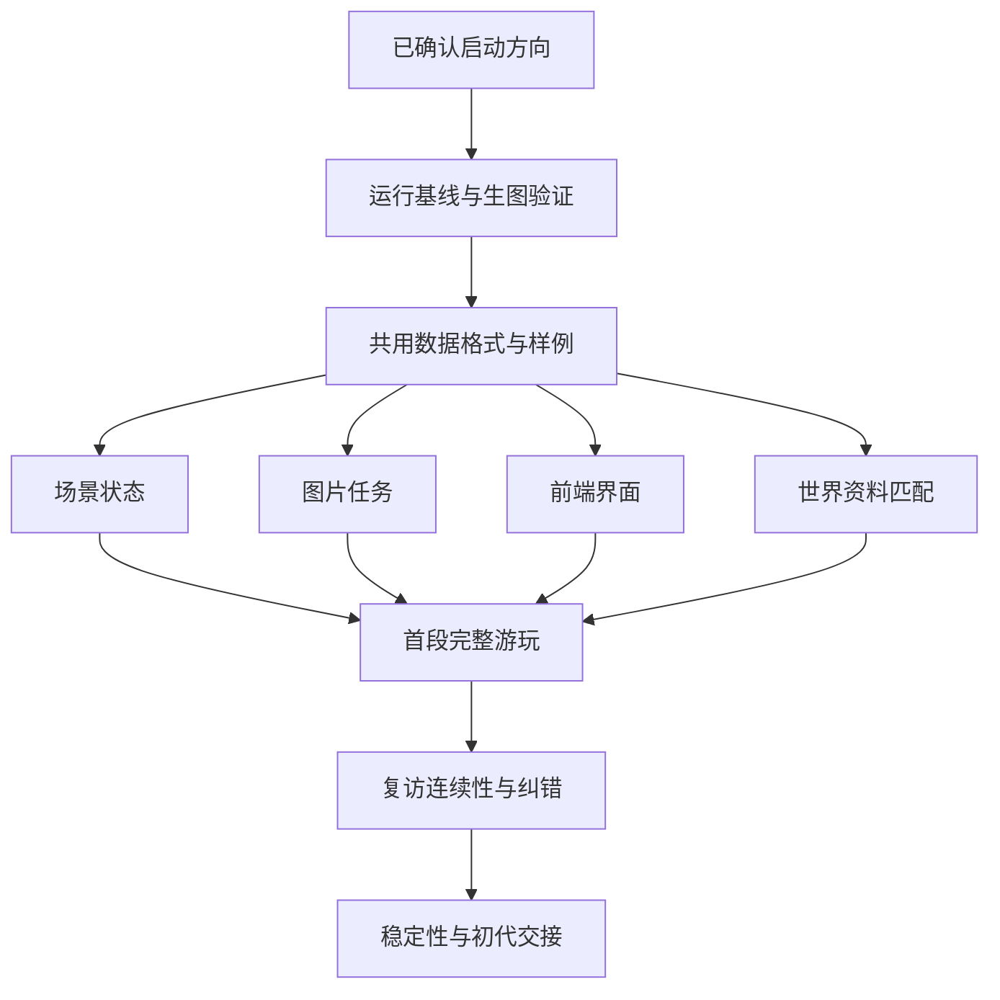

# 映界并行分项目

建议采用五条职责线，但同时活跃的代码开发线先控制在两到三条。总集成由一名负责人维护，资料整理和测试场景可以按需穿插。以下是职责建议，没有指定或通知任何执行者。

| 分项目 | 主要职责与任务 | 何时可以并行 | 交接边界 |
| --- | --- | --- | --- |
| A 基线与总集成 | YJ-01、03、08及合并协调 | 从开始持续贯穿 | 统一数据格式、路由接入、数据库迁移、根依赖与锁文件由同一负责人协调 |
| B 剧情理解与场景状态 | YJ-04、09、10 | YJ-03 后与 C、D 并行 | 输出当前可见状态与出图决策；不直接修改界面或供应商调用 |
| C 图片生成与结果管理 | YJ-02、05，配合09、12 | 能力验证先行；YJ-03 后并行实现 | 接收画面计划，返回任务与图片结果；不擅自增加剧情事实 |
| D 前端与交互 | YJ-06、11，配合12 | YJ-03 后用统一样例先做 | 负责显示与用户操作；不把模型返回状态自行改成剧情结算 |
| E 世界资料与试玩样例 | YJ-07，贯穿09、10、13 | 可先整理现有内容；标签格式在 YJ-03 后对齐 | 负责素材索引、场景样例和问题记录；素材生产规模继续后置 |

必须按顺序完成的是运行路径验证、关键生图能力验证、共用数据格式和第一轮联调。之后，场景状态、图片任务、界面以及资料匹配可以并行。最终的复访调试需要它们已经连接起来。

各开发线使用独立分支或工作副本；不让多个执行者同时改同一套公共接口、迁移和根锁文件。每次交付需说明基线、修改范围、依赖变动、实际检查结果和未完成项。建议每周形成一次能运行的整合版本，尽早暴露接口差异；并行数量不能直接换算成等比例缩短工期。

YJ-01 限定文字基线、YJ-02 工具级图片样例与 [YJ-03 共用契约](contracts/visual-contracts-v0.1.md) 已交付。复核修补包版本为 0.1.1，交换格式仍为 0.1，见[定向修补记录](reports/YJ-03-evidence-review.md)。YJ-04、05 通用部分、06、07 消费同一公共基线；需要时单独接入修补提交，不合并别人的任务交接文件。

YJ-02 的独立后端 API 尚未验证，不阻塞 YJ-03 通用部分，但仍约束 YJ-05 的真实供应商接入。模拟适配器或前端样例不能代替真实联调。分项目代表职责，不表示已经创建独立服务、部署或指派外部开发者。

## 当前并行安排

- B 线入口：[YJ-04 任务书](task-briefs/YJ-04-scene-state.md)，分支 `codex/yj-04-scene-state`。先复跑完整契约检查，再实现真实已保存历史读取、稳定地点和变化持久化；不依赖图片 API。
- C 线入口：`codex/yj-02-backend-readiness`。远端新提交 `340c8bf` 已报告后端条件核查、离线请求准备与模拟传输完成，本轮未复核该批结果；已有获准接口时再按原任务做最小真实验证。真实接入条件不阻塞 04。
- 本次没有启动完整 YJ-05、06、07 开发，也没有向外部开发者派发消息。共享契约、根依赖、数据库迁移和公共接面仍由同一集成负责人协调。
