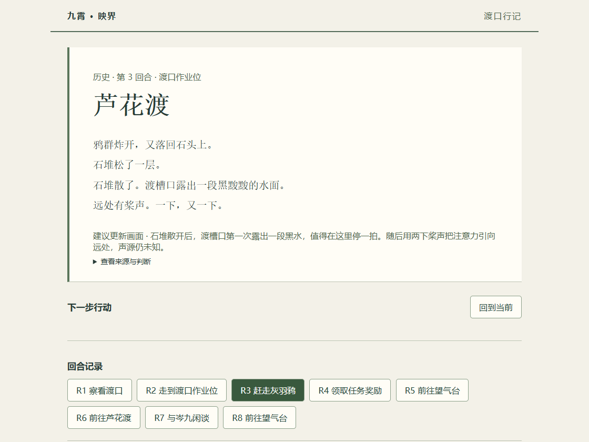

# P05 本地试玩 · 芦花渡与望气台

**试玩入口**　Windows 执行机上双击 [Play-P05.cmd](../../packages/playable-loop/Play-P05.cmd) 开始自己的合成存档。双击 [Review-P05.cmd](../../packages/playable-loop/Review-P05.cmd) 可读本次正式档，直接回看清障、领奖和复访。[启动、恢复和中继说明](../../packages/playable-loop/README.md)

**结论为 `P05_PLAYABLE_RELAY_PASS`，限于这条本地短局的接线。** 工程实测完成八次浏览器行动与两次同局恢复。研究中继收到 8 份状态、8 份时机首答，全部通过本轮机械检查，记录了 19 项显式未知。页面完成点击、刷新、历史回看与返回当前。道主个人试玩反馈待验。

| 回合 | 实际可读正文或后果 | 实际时机首答 | 执行者对照 |
|---|---|---|---|
| 1 察看芦花渡 | 水发黄，船蹭淤泥靠不了岸，岸边芦花倒伏 | 更新 | 开场画面可以交代船为何靠不了岸。无人扶芦花只涉及这个动作，岸上是否有人仍未知。首答对假设编辑没有明确列出使用权条件 |
| 2 到渡口作业位 | 正文只有“你到了芦花渡。”，PG 另记渡口作业位 | 文字 | 正文给出父地点，无法让读者仅凭这一句理解子区域移动。界面在回合栏另列原生子区域 |
| 3 赶走灰羽鸦 | 鸦群惊起又落下，石堆散开，露出黑水，远处传来桨声 | 更新 | 石堆与露出的水面有新画面价值。状态首答把桨声远近与节奏标成 visible，是明确的感知方式错误。时机首答只选石堆和水面，保留划桨者未知 |
| 4 领奖 | 奖励已领取，折桂坪已解锁。领奖入口消失 | 文字 | 高重要性、无新增可见景物。没有补出交接动作或折桂坪景象 |
| 5 去望气台 | 从望气台往南看，山脊上有一片白，正文排除了云 | 更新 | 新地点适合建立视野，白色之物身份仍未知。“第一次转向”强于本轮给出的朝向证据，只能确认此次南望 |
| 6 返回芦花渡 | 再次只有“你到了芦花渡。” | 文字 | 回答把石堆、水面和桨声留在旧观察中，未补成复访时的当前景物 |
| 7 与岑九闲谈 | “嗯。芦花今年开得晚。” | 文字 | 花期属于说法，眼前花况仍未知。角色行动目标可由玩家操作得知，状态题包的正文不足以辨认一个可见人物 |
| 8 再访望气台 | 再次写到南面山脊上的一片白 | 文字 | 同一段可见关系又得到当轮引文支持。读者已读过该段文字，首答未假定读者看过一张图 |



**阅读体验。** 清障正文先写鸦群，继而露出水面，最后只留下桨声，此处的更新建议有具体落点。领奖用一句话就交代了后续可去何处，文字足够。R2、R6 的短句和 R5、R8 完全相同的段落会削弱重访的新鲜感。等待中仍可推进；正式验收为逐轮观察而等候人工中继，该等待不代表玩家必须停读。没有实际显示剧情图片。[领奖后待回传的实拍页面](evidence/YJ-P05-PLAYABLE-LOOP-01/screens/demo-r4.png)

**数据库对账与摘要限制。** 独立授权读回 8 份 PG 回执，对应 9 条单独存储的规则事件。用这些回执重建的 8 份确定性正文 SHA 与首次保存值逐一相等，R5 的移动前态也核实了恢复时位于芦花渡作业位。首次额外对账使用普通 JSON 序列化摘要，R1 即报错，进一步检查发现 8 份重读字节摘要均与返回时不同。这种摘要依赖对象键序；原时点只留了摘要，无法逐字节还原整份原回执并证明唯一差异是键序。保留全部原值和首次失败。宿主已为今后的新记录增加规范化摘要，用离线乱序对象验证；本轮八次提交未回填这一字段，也未追加第九回合。[逐回合原摘要、重读摘要、事件及正文核对](evidence/YJ-P05-PLAYABLE-LOOP-01/native-ledger-check.json)

## 接线和首次故障

真实原生 EmailAuthService 以本地合成邮箱完成鉴权，无外发邮件。规则从固定上游 `f1fe6ea561c5ef4d1ec670b7a406625ce5df774c` 的 B2 已审运行目录加载。专用 PG 存储规则状态。ServerTurnService 启用规则的 deterministic fallback，SQLite 侧车另存实际返回的全文、修订、请求键、归属和回执摘要。读页面时重新鉴权并取得 PG 当前存档；历史条目保留提交时的可读快照，未恢复一般 B2 历史独立证明。

第一次受管探针 LISTEN 成功、CONNECT 返回 EACCES。通过正式权限机制运行同一探针，TCP、HTTP 200 均通过。无 AI 预演在独立账户和库完成八次浏览器行动，八个状态题包全部待处理，页面仍能推进。正式档另行新建。路线、协议、题包格式、规则和通用提示的本地及远端冻结均早于正式首发。[环境与原始故障](evidence/YJ-P05-PLAYABLE-LOOP-01/environment.json) · [预演回合](evidence/YJ-P05-PLAYABLE-LOOP-01/rehearsal-export.json) · [冻结清单](evidence/YJ-P05-PLAYABLE-LOOP-01/freeze.json)

R1 尚未投递时关闭并恢复。Windows 后台后代进程保留了操作脚本的输出管道，宿主已启动而操作脚本仍在等待；改用专用文件采集输出。首次核对又因 Python 元组与 JSON 数组形式不同而报错。持久化前后两份 JSON 实际一致。修正比较后从原 R1 继续，未重演行动。R4 后再次停止宿主与 PG，重开同一存档，从 R5 继续。奖励、正文、原答、分析阶段及题包摘要逐项比对。准备槽、已回传槽各走过一次真实重启。[R1 停止前](evidence/YJ-P05-PLAYABLE-LOOP-01/prepared-restart-before.json) · [R1 恢复后](evidence/YJ-P05-PLAYABLE-LOOP-01/prepared-restart-after.json) · [R4 停止前](evidence/YJ-P05-PLAYABLE-LOOP-01/reward-restart-before.json) · [R4 恢复后](evidence/YJ-P05-PLAYABLE-LOOP-01/reward-restart-after.json)

## 研究边界

状态首答提供实体、属性、观测层、短引和缺证目标。受权规则后果单列；带引文的候选由程序定位、生成 claimId，再由已保存的投影构造时机题包。前序记录带实际处理状态；迟到导入按原 scope 和修订写入。显式未知保留，规则快照继续作为当前地点与奖励的权威。自由文本对象、感知方式、同义词、引文含义及条件中的授权表述仍要人工对照。旧实验的事后标注、作者期待、未来正文没有进入题包。

中继采用既有订阅的独立上下文。操作员从原始会话记录提取首份最终文本，程序原样入库。每个已派发槽保留单包读取轨迹、原答、程序结果和绑定。本机共享文件系统，隔离结论限于观察到的访问行为。订阅精确模型版本、资源消耗未知。执行者作逐轮对照，新独立审核 0。剧情模型、项目 API、图片生成/编辑、真实或模拟图片派发均为 0，额外独立 API 费用 USD 0。画质、真实图片观看节奏、生产、手机真机、道主个人感受均未验收。TIMING-01 PARTIAL、TIMING-01R 有限回放通过及其他上游未结事项仍按原报告。

## 回执与复核

在仓库根目录执行以下只读归档校验和独立结构控制，无需启用订阅对话。

```sh
node packages/playable-loop/verify-export.mjs
node packages/playable-loop/checks.mjs
```

[正式八回合、逐槽结果与摘要](evidence/YJ-P05-PLAYABLE-LOOP-01/demo-export.json) · [实际题包](evidence/YJ-P05-PLAYABLE-LOOP-01/packets) · [原始首答](evidence/YJ-P05-PLAYABLE-LOOP-01/raw) · [浏览器、命令和边界复核](evidence/YJ-P05-PLAYABLE-LOOP-01/checks.json)
