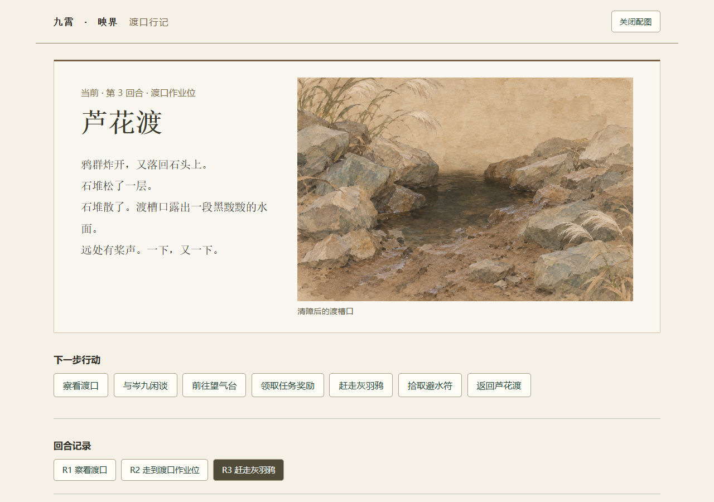

# 渡口行记 · 八回合原生图文试玩

**P05_VISUAL_PLAYABLE_PASS**，适用于本机固定规则、固定路线和三张已审预置原件。双击 [Play-P05-Visual.cmd](../../packages/playable-loop/Play-P05-Visual.cmd) 开始或恢复个人档。双击 [Review-P05-Visual.cmd](../../packages/playable-loop/Review-P05-Visual.cmd) 回看已完成的八回合。个人档已在 Windows 打开，保留第零回合、配图开启。[行动顺序与关停办法](../../packages/playable-loop/visual/README.md)

| 原生行动 | 本局实际画面 |
| --- | --- |
| 1 察看渡口 | 首次显示 [渡口原件](../../packages/playable-loop/visual/assets/I01.png)。黄泥水、吃水深的船身、倒伏芦花同框，其余岸面和人员在画外。 |
| 2 到渡口作业位 | 子区域改变，正文只有抵达父地点。收起开场图。 |
| 3 赶走灰羽鸦 | 首次显示 [清障原件](../../packages/playable-loop/visual/assets/I02.png)。散石之间露出黑水，远处的桨声留给文字。 |
| 4 领取奖励 | 折桂坪解锁。保留本局已经显示过的清障图，标明“上次所见”。关闭配图并停掉宿主与 PG。 |
| 5 前往望气台 | 同档恢复后重新开图，首次显示 [望气台原件](../../packages/playable-loop/visual/assets/I03.png)。南面山脊上一片白，身份未知。 |
| 6 返回芦花渡 | 缺少重新观察，到达的也是父地点。当前无图，旧图可在历史查询。 |
| 7 与岑九闲谈 | 保留原话“嗯。芦花今年开得晚。”，当前无图。 |
| 8 再访望气台 | 当回合再次提供南望与白色区域的依据。重新核对归属和视野后复用 I03，解码字节 SHA 与第五回合一致。 |

## 画面制作与现场证据

三份简报和槽位账本先落盘，再依次占用三个主槽。官方订阅图像工具实际尝试 **3 次、返回 3 张、执行者目视接受 3 张**，定向修正 0。全部为独立生成的 1536 × 1024 PNG。第二张因作业位变化使用独立局部构图；三次均未传参考原件。工具的服务请求 ID、模型 ID、订阅配额消耗和内含成本未知。项目 API、运行时真实或模拟派图、额外独立费用、新增文字首答和模型独审均为 0。[原题摘要与候选绑定](evidence/YJ-P05-VISUAL-LOOP-01/source-bindings.json) · [逐图简报及实际提示](evidence/YJ-P05-VISUAL-LOOP-01/briefs.json) · [调用账本及目视偏差](evidence/YJ-P05-VISUAL-LOOP-01/attempts.jsonl)

纸色、笔触、船身木钉、石头形状和山间点景属于非正典画面选择。旧 R3 状态把桨声标为可见，此处对照正文后剔除。旧 R5 的“第一次转向”超出正文，仅保留此次南望。上述制作判断只用于这三张图，未写回旧首答、评分、原生存档或规则。

## 实机、显示和恢复

Chrome 158.0.8127.38 在新建的专用 PG 和合成身份下实际点了八次行动，全部 accepted。每次从原生回执和确定性正文建绑定，检查规则与内容版本、归属、行动、事件、已完成路线前缀、地点、子区域、奖励状态、正文和规范化回执摘要。服务端按已获准的绑定提供已审文件，逐次核验原件 SHA 和 PNG。浏览器解码、放入页面并确认有可显示面积后登记；历史与当前展示分别去重。两套新档的研究槽均未派发。开关、历史和回执均归该档所有。[前四轮实测](evidence/YJ-P05-VISUAL-LOOP-01/first.json) · [后四轮及故障回读](evidence/YJ-P05-VISUAL-LOOP-01/continue-r6.json) · [每轮绑定与真实显示记录](evidence/YJ-P05-VISUAL-LOOP-01/presentations.json)

第四回合关图、停服务后实际检查宿主活动标记和 PG PID 均已消失，侧车仍在。重新打开同一目录，前四轮正文、归属、奖励、开放行动、图片绑定和开关全部一致。R8 后另开浏览器并刷新，能回读历史图并返回当前。独立玩家档与正式档归属不同，其第零回合无法读取正式档绑定，返回 404。关图后行动按钮可用，刷新后开关仍保持，最后恢复开启。[停机检查](evidence/YJ-P05-VISUAL-LOOP-01/stop.json) · [停机前](evidence/YJ-P05-VISUAL-LOOP-01/restart-before.json) · [重启后](evidence/YJ-P05-VISUAL-LOOP-01/restart-after.json) · [历史回看](evidence/YJ-P05-VISUAL-LOOP-01/readback.json) · [独立入口](evidence/YJ-P05-VISUAL-LOOP-01/reader.json)

PG 授权读回 **8/8** 规范化回执和正文 SHA 匹配，九条独立规则事件逐条相符。固定上游加载器报告规则语义摘要吻合，同时报告构建与插件源的字节 pin 有差异。这里沿用 B2 的语义批准条件。旧八回合普通 JSON 回执字节无法复现的限制继续保留，旧实验的回执与标签均未改动。[上游诊断及逐轮 PG 对账](evidence/YJ-P05-VISUAL-LOOP-01/native-readback.jsonl)

## 首次失败和验收边界

第五回合先成功显示 I03，再对该图片 GET 注入 404 并刷新。页面提示缺图、仍显示正文，随后实际点击进入第六回合。第一次核验迟到访问时，同一测试拦截仍在，取得的是注入的 404。保留 exit 1 与已提交修订；纠正测试后在原第六回合读回，实际宿主拒绝旧当前绑定并返回 409。随后仅提交余下两次行动。结构控制另验缺失与损坏原件、错误归属、版本、地点、子区域、没有实际展示过便不得声称复用等六组条件。旧 P05 归档及九项机械控制均通过。[首次失败](evidence/YJ-P05-VISUAL-LOOP-01/first-failure.json) · [结构控制](evidence/YJ-P05-VISUAL-LOOP-01/controls.json) · [命令及退出码](evidence/YJ-P05-VISUAL-LOOP-01/commands.json)

实测为执行者桌面浏览器验收，道主个人体验与手机真机待验。自由剧情配图、运行时模型接入、训练均未运行。旧 STABILITY/TIMING 状态、old09 待审、H3/B2 缺口、I2 付费上界门禁保持原口径。要回到上一版，关停 visual-reader 和 visual-demo 后使用旧 Play-P05 或 Review-P05 独立入口，旧档无需迁移。
